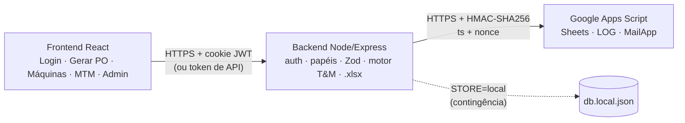

# Auto-T&M Karsten

Sistema web que automatiza a formação de tempos operacionais da Engenharia de Tempos e Métodos e gera a **Ficha de Processo Operacional (PO)** no layout do gabarito oficial.

```
Tempo FIXO (min) = Perímetro de costura (m) × Tempo/metro da máquina
TP (min)         = FIXO + Σ (tempo MTM × frequência)
```

Cenário oficial (`demanda_000.txt`): **FIXO = 6,96 × 0,0964 = 0,6709 min · TP = 0,9409 min**. A ficha gerada é idêntica, célula a célula, ao gabarito `PO-SL-000`, conferido por teste automatizado.

## Arquitetura



| Camada | Responsabilidade |
|---|---|
| **Frontend** (`frontend/`) | Telas de login sem senha, geração de PO (formulário, roteiro arrastável, importação em lote, pré-visualização ao vivo, impressão), CRUD de máquinas e MTM, administração. Não guarda nenhum segredo. |
| **Backend** (`backend/`) | Autenticação (código por e-mail, JWT em cookie `HttpOnly`/`SameSite=Strict`, tokens de API), autorização por papel, validação, **motor de cálculo puro**, leitura de arquivos e geração do `.xlsx`. |
| **Apps Script** (`apps-script/Code.gs`) | Persistência em Planilhas (`TEMPO_CM`, `MATRIZ_MTM`, `USUARIOS`, `TOKENS`, `LOG`), envio do código e da ficha por e-mail. Só aceita chamadas assinadas pelo backend. |
| **Apps Script do Drive** (`apps-script-drive/`) | Projeto separado que guarda as Fichas PO em PDF em `Fichas PO / <ano> / <mês>`. Único escopo `drive.file`: só enxerga o que ele mesmo criou. Só aceita chamadas assinadas pelo backend com `GAS_DRIVE_SECRET`. |

**Dois modos de armazenamento com a mesma interface** (`backend/src/store/`):
- `STORE=google` é a arquitetura alvo: Planilhas + e-mail real.
- `STORE=local` grava em um arquivo JSON e mostra o código de login no console. Serve para desenvolver sem conta Google e é o **plano B da apresentação**: se a rede cair, troca-se uma variável e tudo continua funcionando.

A ficha `.xlsx` é montada no backend (uma única fonte da verdade para o layout, coberta por teste). O Apps Script apenas a anexa ao e-mail.

## Como rodar (modo local, ~2 minutos)

Requisitos: **Node.js 20+**.

```bash
npm run instalar                       # instala backend e frontend
cp backend/.env.example backend/.env   # depois edite: veja abaixo
npm run segredo                        # gera um valor para JWT_SECRET
npm run build                          # compila o frontend
npm start                              # http://localhost:3000
```

No `backend/.env`, preencha:
```
STORE=local
JWT_SECRET=<valor gerado>
ADMIN_EMAIL=seu.email@empresa.com
DEV_EXIBIR_CODIGO=true    # só para ensaio: mostra o código de login na tela
```

Entre com o `ADMIN_EMAIL`. O código aparece na tela (com `DEV_EXIBIR_CODIGO=true`) e no console do servidor. Clique em **Carregar exemplo oficial** para ver a PO-SL-001.

**Desenvolvimento com recarga automática:** em dois terminais, `npm run dev:backend` e `npm run dev:frontend` (http://localhost:5173, com proxy de `/api` para a porta 3000).

## Como rodar (modo Google)

1. Crie uma **Planilha Google** e abra **Extensões → Apps Script**. Cole o conteúdo de `apps-script/Code.gs`.
2. Em **Configurações do projeto → Propriedades do script**, crie:
   - `GAS_SECRET`: gere com `npm run segredo` (o mesmo valor vai para o backend)
   - `ADMIN_EMAIL`: seu e-mail
3. No editor, selecione a função **`setup`** e clique em **Executar**. Autorize o acesso. Isso cria as abas, carrega o Kit de Apoio (9 elementos MTM e 3 máquinas) e cadastra o admin.
4. (Opcional) Execute `testarEmail` para confirmar que o e-mail sai.
5. **Implantar → Nova implantação → App da Web**: *Executar como*: você; *Quem pode acessar*: **Qualquer pessoa**. Copie a URL terminada em `/exec`.
6. No `backend/.env`: `STORE=google`, `GAS_URL=<url /exec>`, `GAS_SECRET=<o mesmo do passo 2>`, `DEV_EXIBIR_CODIGO=false`.
7. `npm start`. O selo no topo da tela muda para **● Google Sheets**.

> A implantação é pública, mas inútil sem o `GAS_SECRET`: toda requisição precisa de assinatura HMAC válida, ter menos de 60 s e um nonce inédito.
> Ao alterar o `Code.gs`, publique uma **nova versão** da implantação (Gerenciar implantações → editar → Nova versão).

**Sem conta Google à mão?** `npm run gas-simulador` executa o próprio `Code.gs` em um simulador local (http://localhost:8787/exec). Suba-o com as mesmas variáveis do backend (`GAS_SECRET=... ADMIN_EMAIL=... npm run gas-simulador`) e use `GAS_URL=http://localhost:8787/exec`. Os e-mails, com o código de login, aparecem no terminal do simulador.

## Guardar fichas no Google Drive (opcional, qualquer modo)

O botão **Guardar no Google Drive** gera o PDF da ficha no navegador (Web Worker, sem travar a tela) e o envia ao backend. O backend exige papel de engenheiro, confere que o arquivo é um PDF, **recalcula a ficha** (o nome do arquivo e o TP gravado na descrição vêm do servidor), assina e repassa ao Apps Script do Drive. Avisos no canto inferior direito acompanham cada etapa, inclusive se você trocar de página.

1. Em https://script.google.com crie um **projeto novo** (não use o da planilha). Cole `apps-script-drive/Code.gs`.
2. Em **Configurações do projeto**, marque *Mostrar o arquivo de manifesto "appsscript.json"* e cole o conteúdo de `apps-script-drive/appsscript.json`. Ele ativa a API avançada do Drive (v3) e restringe o projeto ao escopo `drive.file`.
3. Em **Propriedades do script**, crie `GAS_DRIVE_SECRET` com um valor novo de `npm run segredo` (diferente do `GAS_SECRET`).
4. Execute a função **`configurar`** e autorize. A tela de permissão deve pedir só *"Ver, editar, criar e excluir apenas os arquivos do Google Drive que você usa com este app"*. A pasta `Fichas PO` é criada no seu Drive.
5. **Implantar → Nova implantação → App da Web**: *Executar como*: você; *Quem pode acessar*: **Qualquer pessoa**. Copie a URL `/exec`.
6. No `backend/.env`: `GAS_DRIVE_URL=<url /exec>` e `GAS_DRIVE_SECRET=<o mesmo do passo 3>`. Reinicie o backend.

> Segurança: cada requisição leva HMAC-SHA256 sobre ação, usuário, timestamp, nonce e o **SHA-256 e tamanho do PDF**. O Apps Script rejeita assinatura inválida, requisição com mais de 60 s, nonce repetido, PDF alterado, arquivo que não começa com `%PDF-` e mais de 1 MB. O backend também confere MIME `application/pdf`, extensão `.pdf`, o início `%PDF-` e o limite de 1 MB antes de repassar. Os arquivos não são compartilhados; erros internos do Drive ficam só no log do projeto. O backend limita a 30 fichas por hora por usuário.

**Sem conta Google à mão?** `GAS_DRIVE_SECRET=... node tests/gas-drive-simulador.js` (dentro de `backend/`) roda o próprio `Code.gs` com um Drive em memória em http://localhost:8788/exec e grava os PDFs recebidos em `backend/data/drive-simulado/`.

## Entrada de dados: qualquer formato, inclusive em lote

| Formato | Disposição aceita |
|---|---|
| **.txt** | `Chave: valor` por linha, exatamente como o `demanda_000.txt` oficial |
| **.json** | objeto único, lista, ou `{ "demandas": [...] }` |
| **.csv** (`,` `;` ou TAB) | `chave;valor` por linha **ou** cabeçalho + uma demanda por linha (lote) |
| **.xlsx / .ods** | as mesmas duas disposições do CSV, em qualquer aba |
| **Formulário** | campos + roteiro montado por arrastar e soltar, botões ＋/↑/↓ ou digitando `2.1, 1.1, 3.1` |

- As chaves são reconhecidas com ou sem acento, em várias grafias (`Perímetro costura (em m)`, `perimetro_m`, `Perímetro`…).
- Números aceitam vírgula decimal (`6,96`).
- **Frequência** no roteiro: `2.1x2`, `2.1*2` ou `2.1(2)`.
- Até 50 arquivos por envio; cada demanda é validada individualmente, então uma linha com erro não derruba o lote. O resultado sai em um único `.xlsx`, com uma aba por PO.
- Os cadastros de apoio (`Entradas.ods`/`.xlsx`) podem ser reimportados pela tela **Elementos MTM** (admin). O leitor localiza o cabeçalho pelo conteúdo, então tolera abas renomeadas ou colunas em outra ordem.

**Automação por token de API** (Administração → Tokens):
```bash
curl -H "Authorization: Bearer tm_live_..." -F "arquivos=@demanda_000.txt" \
     "http://localhost:3000/api/po/importar?saida=xlsx" -o PO.xlsx
```

## Papéis

| Ação | Leitor | Engenheiro | Admin |
|---|:-:|:-:|:-:|
| Listar máquinas e MTM | ✓ | ✓ | ✓ |
| Gerar, exportar e receber a PO por e-mail |  | ✓ | ✓ |
| Criar, editar e desativar máquinas e MTM; importar cadastros |  |  | ✓ |
| Gerenciar usuários e tokens; ver auditoria |  |  | ✓ |

O papel é lido do cadastro a cada requisição (cache de 30 s), não do JWT. Rebaixar ou desativar alguém vale na hora, sem esperar a sessão expirar.

## API

| Método | Rota | Papel mínimo | Descrição |
|---|---|---|---|
| POST | `/api/auth/solicitar-codigo` | público | Envia o código de 6 dígitos (resposta idêntica para e-mail não cadastrado) |
| POST | `/api/auth/verificar-codigo` | público | Valida o código e define o cookie de sessão |
| POST | `/api/auth/logout` | logado | Encerra a sessão |
| GET | `/api/auth/eu` | logado | Usuário atual e modo de armazenamento |
| GET | `/api/maquinas` | leitor | Máquinas ativas (`?inativas=1` para admin) |
| POST · PUT · DELETE | `/api/maquinas[/:codigo]` | admin | CRUD (DELETE = desativação lógica) |
| POST | `/api/maquinas/:codigo/reativar` | admin | Reativa |
| GET | `/api/mtm` | leitor | Matriz de elementos |
| POST · PUT · DELETE | `/api/mtm[/:codigo]` | admin | CRUD |
| POST | `/api/catalogo/importar` | admin | Upload de `Entradas.ods/.xlsx` |
| POST | `/api/po/preview` | engenheiro | Calcula e devolve a PO em JSON |
| POST | `/api/po/importar` | engenheiro | Upload de 1..50 arquivos (`?saida=xlsx` devolve a planilha) |
| POST | `/api/po/exportar` | engenheiro | `.xlsx` de 1..N POs |
| POST | `/api/po/enviar` | engenheiro | Envia o `.xlsx` **sempre** para o e-mail do usuário autenticado |
| GET · POST | `/api/admin/usuarios` | admin | Lista / cria ou edita |
| GET · POST · DELETE | `/api/admin/tokens[/:id]` | admin | Tokens de API (só o hash é guardado) |
| GET | `/api/admin/log` | admin | Auditoria |

Erros de negócio voltam como `422 { erro, erros: [...] }`, com todas as pendências de uma vez (código MTM inexistente, máquina inexistente, perímetro inválido…).

## Testes

```bash
npm test
```

**Testes** em quatro suítes:
- `motor.test.js`: cálculo, leitores (txt/json/csv/lote) e **comparação célula a célula com o gabarito oficial**;
- `api.test.js`: API ponta a ponta (login, 401/403/422, lote, soft delete, token, e-mail), executada **duas vezes**: no modo local e no modo Google, com o `Code.gs` real rodando no simulador;
- `gas.test.js`: segurança do Apps Script (assinatura falsa, requisição vencida, replay, papel conferido de novo, e-mail fora do cadastro).
- `drive.test.js`: Apps Script do Drive (pastas ano/mês, assinatura, replay, PDF adulterado, nome malicioso, erros sem vazamento) e a rota `POST /api/po/drive` de ponta a ponta.

## Segurança

- `JWT_SECRET`, `GAS_SECRET` e `GAS_DRIVE_SECRET` ficam só em `.env` e nas Propriedades do script; o repositório traz apenas o `.env.example`.
- Cookie `HttpOnly` + `SameSite=Strict` (+ `Secure` em produção). CORS desligado por padrão: frontend e API na mesma origem.
- Códigos de login guardados apenas como HMAC, com validade de 10 min, máximo de 5 tentativas e 30 s entre reenvios. Rate limit por IP + e-mail.
- Tokens de API guardados como SHA-256 e exibidos uma única vez.
- O destinatário de e-mails é derivado do usuário autenticado e assinado, nunca do corpo da requisição.
- Defesa em profundidade: o Apps Script reconfere o papel na aba `USUARIOS` antes de qualquer escrita.
- Auditoria de logins, acessos negados (403), alterações de cadastro e POs geradas/enviadas.

## Estrutura

```
auto-tm-karsten/
├── apps-script/Code.gs            # Planilhas + HMAC + MailApp + setup()
├── apps-script-drive/             # Fichas PO em PDF no Drive (escopo drive.file) + HMAC
├── backend/
│   ├── src/core/motorTM.js        # cálculo puro (FIXO, TP, RPM ±10%)
│   ├── src/ingest/                # leitores: catálogo e demandas (txt/json/csv/xlsx/ods)
│   ├── src/export/fichaPO.js      # .xlsx idêntico ao gabarito, com fórmulas vivas
│   ├── src/auth/                  # códigos, JWT, tokens, papéis
│   ├── src/store/                 # local.js | google.js (mesma interface) + cache
│   ├── src/routes/                # auth, cadastros, po, admin
│   ├── data/Entradas.ods          # Kit de Apoio (semente do modo local)
│   └── tests/                     # testes + simuladores dos dois Apps Scripts
├── frontend/src/                  # React + Vite + Tailwind
└── docs/PITCH.md                  # roteiro da apresentação
```

## Decisões e premissas

- **Arredondamento**: FIXO e TP com 4 casas, como no gabarito (0,670944 → 0,6709).
- **Frequência**: o gabarito tem a coluna; o TP soma `tempo × frequência` (com frequência 1, é a soma simples do regulamento).
- **Linha TP**: o gabarito não tem a linha de total, mas o regulamento (item 3.3) exige o TP. Ela foi acrescentada logo abaixo dos elementos; as células A1:E11 continuam idênticas.
- **Fórmulas vivas no .xlsx**: limites de RPM (`=D6*0.9`, `=D6*1.1`), FIXO (`=ROUND(E4*tempo_metro;4)`) e TP (`=ROUND(SUMPRODUCT(...);4)`). Se o engenheiro mudar o perímetro na planilha, tudo recalcula.
- **Equipamento** na ficha = *tipo* da máquina (ex.: "Interlock"), como no gabarito. O modelo (Jack C4) aparece na tela.
- **Leitura de .ods**: feita pela biblioteca SheetJS 0.18.5 (última versão no npm). Ela lida mal com células mescladas em `.ods`; para planilhas de entrada isso não afeta a leitura, que localiza o cabeçalho pelo conteúdo.
